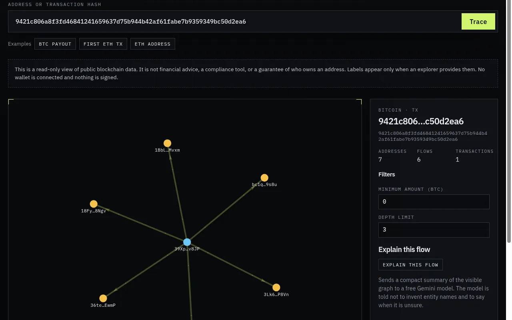

# Crypto Flow Graph

Paste a Bitcoin or Ethereum address or transaction hash and see an interactive graph of how funds move between addresses.

**Live demo:** https://crypto-flow-graph.vercel.app

The demo opens with a real Bitcoin transaction already loaded. This is a read-only tool. There is no wallet connection, no signing and no real-money transfer.



## Features

- Automatic detection of Bitcoin and Ethereum addresses and transaction hashes
- Force-directed graph of addresses (nodes) and transfers (edges), with amounts on each flow
- Node colours for the searched address, senders, recipients, addresses that do both, and contracts
- Click an address to load more of its recent transactions and expand the graph
- Click a flow (or use the side panel) to open the transaction in [mempool.space](https://mempool.space) or [Etherscan](https://etherscan.io)
- Filters for minimum amount and expansion depth
- Optional **Explain this flow** button that sends a compact summary to a free Gemini model

## Tech stack

- [Vite](https://vite.dev) + [React](https://react.dev) + TypeScript
- [force-graph](https://github.com/vasturiano/force-graph) for the interactive canvas
- Bitcoin data from the public [mempool.space API](https://mempool.space/docs/api/rest) (no key)
- Ethereum address history from the public [Blockscout](https://eth.blockscout.com) API (no key). A plain Ethereum JSON-RPC node cannot list an address's transactions, so the app uses Blockscout for that case and can fall back to a public RPC when a transaction hash is looked up
- Vitest unit tests (input detection, chain parsers, graph building and filters, API handler)
- GitHub Actions CI (lint, type check, tests, build) with no secrets
- Deployed on [Vercel](https://vercel.com)

## How it works

The input is classified as a Bitcoin or Ethereum address or transaction. Bitcoin transactions are turned into flows by allocating each output across the input addresses in proportion to the amount they spent (change back to the same address is omitted). Ethereum transfers use the native value on each transaction, plus internal transfers when Blockscout provides them. Zero-value contract calls are omitted from address history so the graph stays focused on funds.

Address lookups start from the most recent page returned by the explorer API (typically up to 50 transactions). Clicking a node loads that address's recent transactions and merges them into the graph, with a depth limit so the view does not explode. Responses are cached briefly so repeats do not hit the public APIs again.

The explanation endpoint accepts a compact graph summary, not a free-form prompt. The model is instructed not to invent exchange, person or service labels, and to say when it is unsure. The API key lives only in Vercel environment variables and is never committed. Requests are rate-limited and the payload is capped.

## Limits

- Only public mainnet data is used. There is no wallet support and no testnet mode.
- Address graphs show a recent page of transactions, not a full lifetime history.
- Public APIs may rate-limit or omit some data. Missing counterparties or amounts are not inferred.
- Bitcoin flows in a many-input, many-output transaction are a proportional allocation, not a unique on-chain path from one input to one output.
- Ethereum ERC-20 token transfers are not graphed; the view is native ETH (and internal ETH transfers when available).
- The AI explanation can only use the summary it is given. It must not be treated as an identity or risk rating.

## Running it yourself

Requires Node.js 20.9+.

```bash
npm install
npm test
npm run dev
```

The Vite dev server also serves `/api/explain`. To try the optional explanation locally, copy `.env.example` to `.env` and set `GEMINI_API_KEY`. Leave it unset if you only want the graph.

## License

[MIT](LICENSE)
